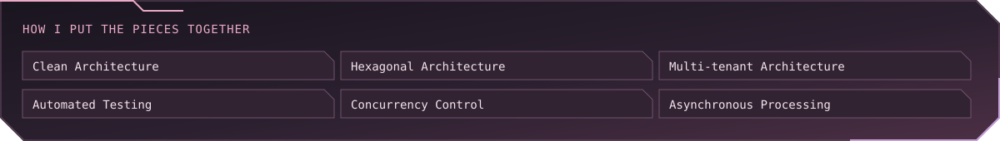
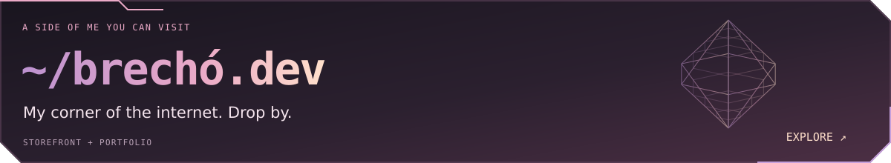
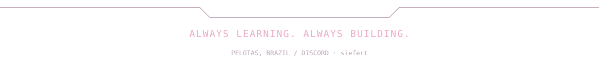

<!-- Upload README.md and assets/ together. Artwork has desktop and mobile layouts. -->

<picture>
  <source media="(max-width: 600px)" srcset="./assets/identity-mobile.svg" />
  
</picture>

 

 

<picture>
  <source media="(max-width: 600px)" srcset="./assets/about-mobile.svg" />
  
</picture>

 

  <a href="https://www.linkedin.com/in/andriosiefert/"><picture><source media="(max-width: 600px)" srcset="./assets/link-linkedin-mobile.svg" /></picture></a>
  <a href="https://github.com/AndrioSiefert"><picture><source media="(max-width: 600px)" srcset="./assets/link-github-mobile.svg" /></picture></a>
  <a href="https://www.instagram.com/andriosiefert/"><picture><source media="(max-width: 600px)" srcset="./assets/link-instagram-mobile.svg" /></picture></a>

  <a href="mailto:andriojob@gmail.com"><picture><source media="(max-width: 600px)" srcset="./assets/link-gmail-mobile.svg" /></picture></a>
  <a href="https://brechodev.com.br/portfolio"><picture><source media="(max-width: 600px)" srcset="./assets/link-web-mobile.svg" /></picture></a>

 

<picture>
  <source media="(max-width: 600px)" srcset="./assets/stack-languages-mobile.svg" />
  
</picture>

 

<picture>
  <source media="(max-width: 600px)" srcset="./assets/stack-frontend-mobile.svg" />
  
</picture>

 

<picture>
  <source media="(max-width: 600px)" srcset="./assets/stack-ai-mobile.svg" />
  
</picture>

 

<picture>
  <source media="(max-width: 600px)" srcset="./assets/stack-data-mobile.svg" />
  
</picture>

 

<picture>
  <source media="(max-width: 600px)" srcset="./assets/stack-infra-mobile.svg" />
  
</picture>

 

<picture>
  <source media="(max-width: 600px)" srcset="./assets/stack-integrations-mobile.svg" />
  
</picture>

 

<picture>
  <source media="(max-width: 600px)" srcset="./assets/practices-mobile.svg" />
  
</picture>

 

<a href="https://brechodev.com.br">
<picture>
  <source media="(max-width: 600px)" srcset="./assets/brechodev-mobile.svg" />
  
</picture>
</a>

 

<picture>
  <source media="(max-width: 600px)" srcset="./assets/footer-mobile.svg" />
  
</picture>
