<!-- Upload README.md and assets/ together. Artwork has desktop and mobile layouts. -->

<picture>
  <source media="(max-width: 600px)" srcset="./assets/identity-mobile.svg" />
  
</picture>

 


 

<picture>
  <source media="(max-width: 600px)" srcset="./assets/about-mobile.svg" />
  
</picture>

 

  <a href="https://www.linkedin.com/in/andriosiefert/"><picture><source media="(max-width: 600px)" srcset="./assets/link-linkedin-mobile.svg" />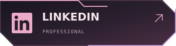</picture></a>
  <a href="https://github.com/AndrioSiefert"><picture><source media="(max-width: 600px)" srcset="./assets/link-github-mobile.svg" />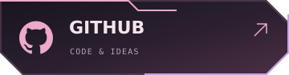</picture></a>
  <a href="https://www.instagram.com/andriosiefert/"><picture><source media="(max-width: 600px)" srcset="./assets/link-instagram-mobile.svg" />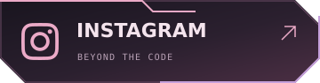</picture></a>

  <a href="mailto:andriojob@gmail.com"><picture><source media="(max-width: 600px)" srcset="./assets/link-gmail-mobile.svg" />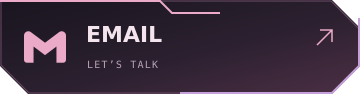</picture></a>
  <a href="https://brechodev.com.br/portfolio"><picture><source media="(max-width: 600px)" srcset="./assets/link-web-mobile.svg" />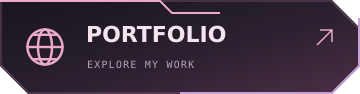</picture></a>

 

<h2 align="center">From interface to infrastructure.</h2>

The tools I use to build web applications, connect systems and work with AI.

 

<picture>
  <source media="(max-width: 600px)" srcset="./assets/stack-core-mobile.svg" />
  
</picture>

 
 

<picture>
  <source media="(max-width: 600px)" srcset="./assets/stack-systems-mobile.svg" />
  
</picture>

 
 

<picture>
  <source media="(max-width: 600px)" srcset="./assets/stack-network-mobile.svg" />
  
</picture>

 

<strong>Explore the full stack — text version</strong>

<h4 align="center">Languages &amp; runtime</h4>

TypeScript · JavaScript · Python · Node.js · Bash · Java · PHP · pip

<h4 align="center">Frontend &amp; interfaces</h4>

React · Vite · Tailwind CSS · TanStack Query · Next.js · React Hook Form · Zod · Chart.js

<h4 align="center">Backend &amp; AI</h4>

NestJS · FastAPI · OpenAI API · n8n · Express · TypeORM · AI agents · Multimodal AI

<h4 align="center">Data &amp; messaging</h4>

PostgreSQL · Redis · BullMQ · RabbitMQ · MinIO · Supabase · SQL · JSONB · MySQL · MongoDB

<h4 align="center">Linux &amp; infrastructure</h4>

Linux · Docker · Docker Compose · Git · Terminal · Docker Swarm · NGINX · Traefik · GitHub Actions

<h4 align="center">APIs &amp; integrations</h4>

REST APIs · Webhooks · SSE · OAuth 2.0 · JWT · WhatsApp API · Google Calendar · Asaas

 
 

<h2 align="center">Built to hold together.</h2>

Architecture, data consistency and testing are part of the build.

 

<picture>
  <source media="(max-width: 600px)" srcset="./assets/engineering-flow-mobile.svg" />
  
</picture>

 

<strong>A closer look at my engineering practices</strong>

<h4 align="center">Architecture that can evolve</h4>

Clean Architecture, Hexagonal Architecture and multi-tenant systems with workspace isolation and permission-based access.

<h4 align="center">Reliable data and background work</h4>

Concurrency control, database transactions and asynchronous processing with queues, retries and idempotent operations.

<h4 align="center">Testing beyond the happy path</h4>

Automated unit and integration tests, concurrency scenarios and contract validation between services.

 
 

<h2 align="center">A side of me you can visit.</h2>

 

<a href="https://brechodev.com.br">
<picture>
  <source media="(max-width: 600px)" srcset="./assets/brechodev-feature-mobile.svg" />
  
</picture>
</a>

  <a href="https://brechodev.com.br">Visit BrechoDev</a> &nbsp; · &nbsp; <a href="https://brechodev.com.br/portfolio">View my portfolio</a>

 
 

<picture>
  <source media="(max-width: 600px)" srcset="./assets/profile-divider-mobile.svg" />
  
</picture>

<strong>Always learning. Always building.</strong>

Pelotas, Brazil &nbsp; · &nbsp; Discord: <code>siefert</code>

